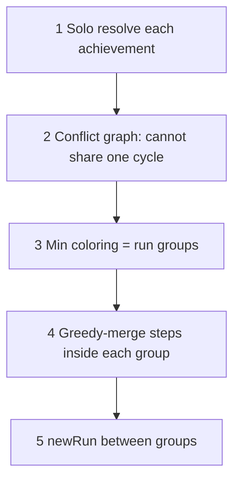

# Route planner algorithm

## Goal

Turn selected achievements into one short action list. Shared work inside a cycle is done once. Extra cycles appear only when achievements cannot share a single world cycle.

## World state

| Field | Meaning | Cleared by `newRun`? |
|-------|---------|----------------------|
| `done` | Once-only actions completed since the last reset | Yes |
| `results` | Result flags | Only those without `persist: true` |
| `inventory` | Item counts | Only items without `persist: true` |
| `everDone` | Actions ever performed (achievement ledger) | **Never** |
| `run` | Display index | Bumped on `newRun` |

`requires: { type: "action" }` must hold in **`done`** (this cycle). Achievement conditions use **`everDone`**.

Persist is per **item** / **result** (`persist: true`). There is no type-level persist list.

## Algorithm: group-and-merge

### 1. Solo resolve

For each selected achievement, greedily walk its dependency tree (requires, inventory givers, results, `before` missables) and record a step list. If any solo plan fails, the whole route fails.

### 2. Same-cycle conflicts

Achievements A and B **conflict** if resolving `{A, B}` from an empty world with **`newRun` forbidden** fails. Typical causes: mutually exclusive endings, the same once-only boss soul consumed twice, `before` deadlocks.

### 3. Minimum groups (runs)

Build an undirected conflict graph. Color it so each color class is a set of achievements that can share one cycle.

- **n ≤ 18:** exact minimum coloring (DP over independent sets)
- **n > 18:** greedy Welsh–Powell (degree order)

Fewer colors ⇒ fewer cycles.

### 4. Merge inside a group

For each color class, run the same greedy resolver on the whole group together. Shared prerequisites appear once; order follows requires / `before`.

### 5. Stitch groups

Process groups in selection order. Between groups, if the current cycle still has progress (`done` non-empty), perform a `newRun` action (and pack any remaining group work that still fits before the reset).

## Greedy resolver (used in steps 1, 2, 4, 5)

- `ensureSatisfied` — achievement leaves: once in `everDone` is enough
- `ensureDone` — action requirements: must be in `done` this cycle
- Inventory / results pulled via givers and setters
- Preferred `before` missables pulled before their blockers
- `newRun` when a once-only action must be repeated or a `before` is blocked; optional pack-before-reset

## What this optimizes / does not

**Optimizes:** number of cycles (groups), then a fast greedy merge per cycle.

**Does not guarantee:** globally fewest *actions* (A* over full state space would; it was too slow). Incomplete game data still yields incomplete routes.

## Code

[`src/route.js`](../src/route.js) — `planRoute`, `validateGame`  
[`src/route.check.js`](../src/route.check.js) — fixtures
