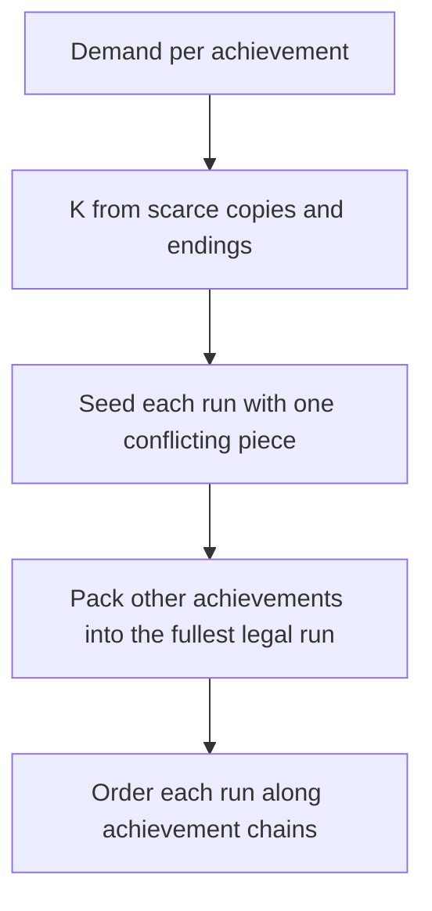

# Route planner algorithm

## Goal

Turn selected achievements into one short action list. The number of runs is the number of times a once-only reward must be produced. Other achievements join the fullest run that can hold them. Steps inside a run follow achievement chains.

## World state

| Field | Meaning | Cleared by `newRun`? |
|-------|---------|----------------------|
| `done` | Once-only actions completed since the last reset | Yes |
| `results` | Result flags | Only those without `persist: true` |
| `inventory` | Item counts | Only items without `persist: true` |
| `everDone` | Actions ever performed (achievement ledger) | **Never** |
| `run` | Display index | Bumped on `newRun` |

`requires: { type: "action" }` must hold in **`done`** (this cycle). Achievement conditions use **`everDone`**.

Persist is per **item** / **result** (`persist: true`). There is no type-level persist list.

## Algorithm

### 1. Run count

Expand the selected achievements, including nested achievements. For an `any` condition, keep the branch with the smallest copy count. That choice is per condition, not a search over combinations of branches.

`K` is at least 1. It is also at least the number of demanded `newRun` actions, and at least `ceil(consumed / produced per cycle)` for each item that has no repeatable giver. A farm never forces another run. Adding an achievement only adds demand, so this bound cannot fall.

One achievement can occupy several runs. Knight's Honor forges three weapons from Sif's soul, and that soul is produced once per cycle, so that achievement is three runs.

### 2. Seed

Each consumer of a scarce item is its own piece. Pieces that share an item go into different runs, up to what one cycle can produce.

Demanded endings occupy cycle boundaries first. Extra boundaries use a `newRun` action that no achievement points at (`begin-next-cycle` in Dark Souls Remastered), and that filler is repeated before an ending is repeated. The last cycle still plays a demanded ending when the selection needs that action and there is no later cycle to put it in.

### 3. Pack

Every other achievement is a guest. Guests that fit in fewer runs are seated first. A guest joins the legal run that already holds the most achievements. Ties go to the earlier run, so the first cycle is the fullest and the reset comes after that work.

A guest fits when its actions, closed under `requires`, givers, result setters, and demanded `before` missables, can be ordered and the run still produces every item it consumes. Runs are not reordered after packing.

### 4. Order

Inside a run, prerequisites, givers, and setters come first. A missable comes before the blocker named in `before`. The `newRun` step is last. Among ready actions, the achievement packed earliest in that run goes first. The final tie-break is the action id.

A repeatable giver is emitted `ceil(still needed / amount given)` times. Two teeth from a farm that gives one take two farm steps in the same run.

The same boss in a later run pulls its `requires` chain again, because a new cycle clears `done`.

## What this optimizes / does not

**Optimizes:** fewest cycles implied by scarce copies and endings, then the fullest legal run for everything else.

**Does not guarantee:** a shortest walk of the map. There is no area graph. An `any` branch is chosen by its own copy count. If a result puzzle has no `consumes` and no `before`, a piece that fits no current run opens one more cycle.

## Code

[`src/route.js`](../src/route.js) — `planRoute`, `validateGame`

[`src/route.check.js`](../src/route.check.js) — fixtures
